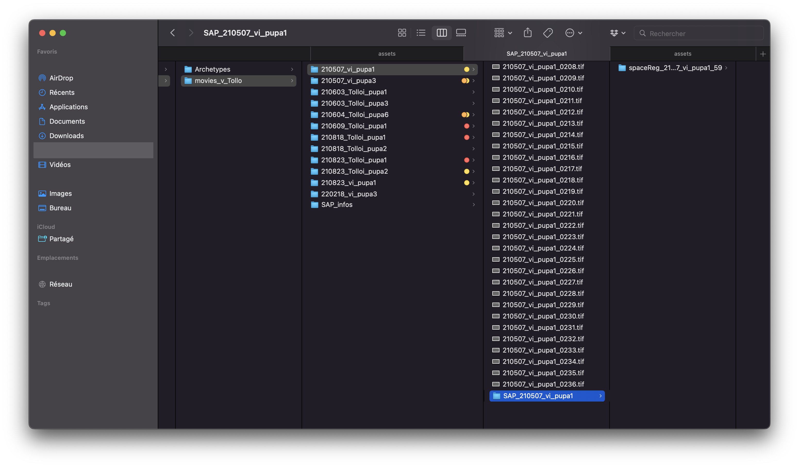
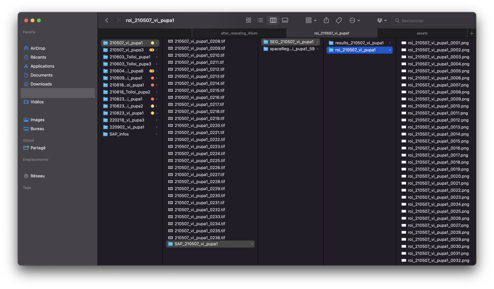

# Adding masks and segmentation to images

At some point in the analysis, the following steps may be needed:

1. **Add a ROI mask to the movies:**

   This allows exclusion of regions outside the notum (or other areas that should not be quantified) from the analysis. It also enables better segmentation by linking masks with the movies when requesting a segmentation.

2. **Add a segmentation mask to the movies:**

   This allows launching all **PostSegmentation** analyses such as `cellTracking` (`CT`) and `SegmentedImageAnalysis` (`SIA`), providing more precise measurements of cellular processes.

Adding masks and segmentation requires creating a specific folder architecture as described below.

**Note:** For information on generating ROI or segmentation masks, refer to the relevant tools and documentation for the project.

## 1. Regarding folder structure

This guide assumes the previous tutorials on preparing movies and performing SR have been followed, resulting in a folder architecture that looks like this for each movie:

If that is not the case, complete those steps first.

Start by creating in each animal folder a folder called `SEG_name_of_the_animal`. Inside that folder, two subfolders are needed -- one for the ROI mask and one for the segmentation mask.

1. Create a folder called `roi_name_of_the_animal`
2. Create a folder called `results_name_of_the_animal`
3. Copy all ROIs and segmentation masks into their respective folders. **Note:** Add `.png` to the end of each filename if the extension is not already present.
4. Rename every file according to the `filenameRaw` variable, using `roi_` as a prefix for the ROI masks and `seg_` for the segmentation masks (e.g., if `filenameRaw = {'210507_vi_pupa1_'};`, the first ROI file should be named `roi_210507_vi_pupa1_0001.png` and the first segmentation file should be named `seg_210507_vi_pupa1_0001.png`).

The final structure should look like this:

## 2. Regarding the files themselves

Both mask types are PNG images with the same pixel dimensions as the raw images, one per frame, numbered like the raw images (see the naming rules above).

- **ROI masks** are binary images in which white marks the region to analyze; black regions are excluded from the quantifications. If no ROI mask is provided for a frame, the entire image is analyzed.
- **Segmentation masks** are the binary watershed output: white cell bodies separated by a one-pixel-wide black skeleton marking the membranes.

## 3. Next steps

The remaining setup — creating one `SAP_info` file per movie and filling in its variables — is independent of the masks and is covered in sections 4 and 5 of [Preparing movies](preparing_movies.md).

Next page: [Performing SpaceRegistration with SR](space_registration.md)
