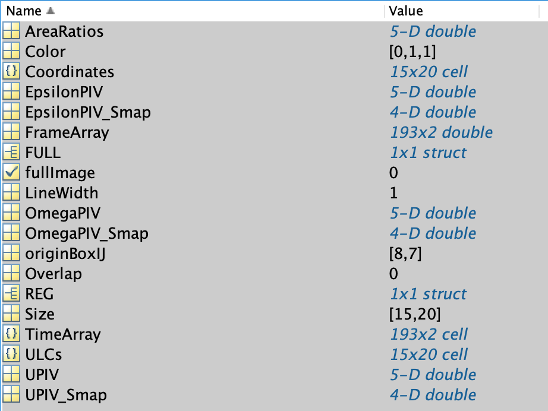

# Comparing Animals with AOA

**Warning:** This guide assumes that an analysis such as `PIV` or `VM` has already been run and then averaged using AOT. If that is not the case, refer to the previous guide on [Running AOT](average_over_time.md).

## 0. Introduction

`AOA` (AverageOverAnimals) averages the values contained in each animal's AOT backup. These values can be used to compare the respective `EpsilonPIV` fields across animals in order to rescale them in time.

## 1. Launching the analysis

As this part of the pipeline deals with multiple animals simultaneously, it uses the script `MAP_parameters.m`. Start by defining the animals to study. The animal lists remain the same as in the previous steps of this tutorial:

```matlab
%% ANIMALS TO INCLUDE %%

% Definition of animal lists often use for analysis:
%--------------------------------------------------------------------------
% Animal lists:
avgAnimals_v = {'210507_vi_pupa1';'210507_vi_pupa3'; '210823_vi_pupa1'; '220218_vi_pupa3'; '220902_vi_pupa1'}
avgAnimals_Tollo = {'210603_Tolloi_pupa1'; '210603_Tolloi_pupa3'; '210604_Tolloi_pupa6'; '210818_Tolloi_pupa2'; '210823_Tolloi_pupa2'}

%--------------------------------------------------------------------------
% Animals to take into account in the average (selection of one of the above list)
%--------------------------------------------------------------------------
mapAnimal = 'avgAnimal';                                               % name of average animal OR actual animal name (BIG1, TRBL4...) when processing single animal
avgAnimals = [avgAnimals_v; avgAnimals_Tollo];
PathName = '/path/to/movies/movies_v_Tollo';                             % Global output path: all outputs will be saved there in a structure file.

% ALL animals to consider to build common grid:
%--------------------------------------------------------------------------
% allAnimals = [avgAnimalsWhite ; avgAnimalsActn];
allAnimals = avgAnimals;
%--------------------------------------------------------------------------


```

Next, set `AOA = 1`:

```matlab

%% Operation Name (Oname) Selection / PROGRAMS TO RUN %%

% PRE-segmentation
RA = 0;                % "RescaleAnimals"

% POST-segmentation
AOA = 1;               % "AverageOverAnimals"
DBA = 0;               % "DifferenceBetweenArchetypes"
POA = 0;               % "ProjectionOverAnimals"
PTE = 0;               % "PlotTimeEvolution"

```

Finally, set the AOT values that will be averaged across all animals:

```matlab
%% Quantities to be PLOTTED and PROJECTED
%%%%%%%%%%%%%%%%%%%%%%%%%%%%%%%%%%%%%%%%%%%%%%%%%%%%%%%%%%%%%%%%%%%%%%%%%%%%%%%%%%%%%%%%%%%%%%%
Qname = {'UPIV' ; 'EpsilonPIV' ; 'OmegaPIV'};

% NB: ALL quantities are CALCULATED anyway in AOA, DBA, *BUT* in POA, ONLY those listed here will be calculated and plotted in POA
%%%%%%%%%%%%%%%%%%%%%%%%%%%%%%%%%%%%%%%%%%%%%%%%%%%%%%%%%%%%%%%%%%%%%%%%%%%%%%%%%%%%%%%%%%%%%%%

% Plot projected quantities with corresponding 'i','d','do' tags (e.g. EGdotEG_d)
tagProjPlot = {'d'}; 
scaleRatioFactor = 0.15;

% NB: "makePlotsAllAOT" in SAP_parameters must ALSO authorize plot
skipAOAplots = false; 
```

Setting `skipAOAplots = false` enables plotting of the averaged fields. **However, the variable `makePlotsAllAOT` in `SAP_parameters.m` must also be set to ones for plotting to work.** This is because `MAP_parameters.m` reuses variables from `SAP_parameters.m` to avoid duplicate variable names.

**Run the `MAP_parameters.m` script.**

A prompt appears to define the grid for the analysis. Click Yes.

*On an M1 Mac with 16 GB RAM, processing with three values takes roughly 1--2 minutes.*

## 2. Results of the analysis

A new folder appears in the base directory for each time interval set in `AOT`, each containing the values that `AOT` computed. With `timeWidthAll = [Inf; 2; 4]` and `averageOverAll = {'VM'}` as configured in the previous chapter, the output folders are:

* AOA_avgAnimal_2h_0.96olap
* AOA_avgAnimal_4h_0.98olap
* AOA_avgAnimal_18h_0olap

Each of these folders contains an AOA backup with the average values for EpsilonPIV, UPIV, and OmegaPIV.



## 3. Next steps

At this point, all values have been averaged across animals on a common grid. The next step is to select a particular region in the tissue and examine the occurrence of the division, rotation, or migration peak. This allows for time-wise rescaling of all animals for subsequent comparison.

Proceed to: [Using PTE to compare tissue dynamics across animals at specific locations](plot_time_evolution.md)
