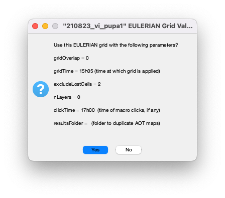
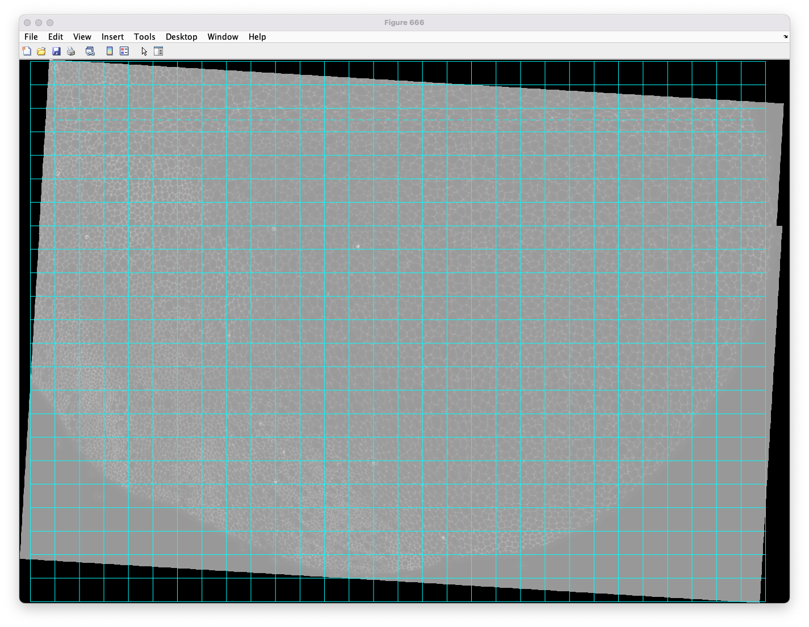
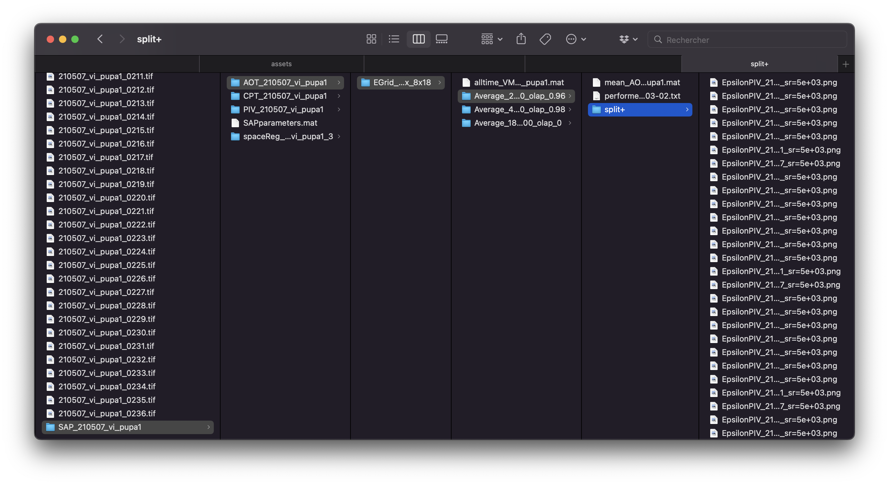
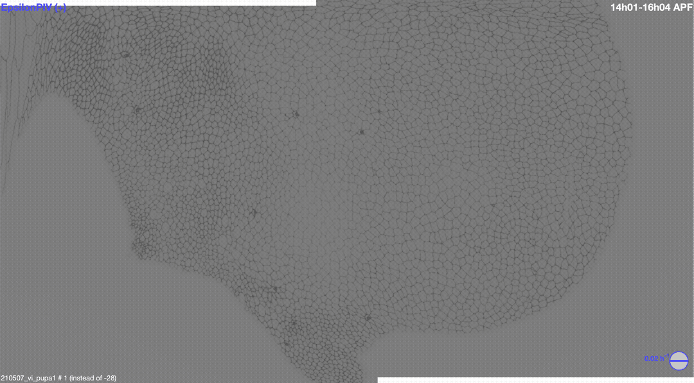

# Running AOT

**Warning:** This guide assumes that any analysis that can be averaged (such as `PIV` or `VM`) has already been run for the movie. If that is not the case, refer to the previous guides on [Running PIV](piv.md) or [Running VM](velocity_maps.md).

## 0. Introduction

`AOT` (AverageOverTime) computes and plots time-averaged values from previous analyses. Average values are computed inside a sliding window that moves along the time axis.

## 1. Launching the analysis

As usual, start by setting `AOT = 1`:

```matlab
%% PROGRAMS TO RUN %%

% PRE-segmentation
TR =    0;                                  % "TimeRegistration" (NO PARAMETERS) (7.12) 
SR =    0;                                  % "SpaceRegistration" (NO PARAMETERS) (7.12) 
PIV =   0;                               % "ParticleImageVelocimetry"
GEP =   0;                                  % "GeneExpressionPattern"
VM =    0;                                  % "VelocityMaps" (with modeVM = 'PIV' OR after cell tracking with modeVM = 'CT')

% POST-segmentation
FFPB =  0;                                  % "FilterFourPixelBlocks" (NO PARAMETERS)
SIA =   0;                                  % "SegmentedImageAnalysis"
CT =    0;                                  % "CellTracking" (NO PARAMETERS)(7.8)
% NB: "HC" ALWAYS RUNS (not in SAP/MAPcall) % "HolesCorrection" (NO PARAMETERS) (8.8) 
CTD =   0;                                  % "CellTrackingDisplay"
CPT =   0;                                  % "CellPatchTracking"
CTA =   0;                                  % "CellTrackingAnalysis" (can also run before CPT in full image mode)
AOS =   0;                                  % "AverageOverSpace"
TA =    0;                                  % "TensorAnalysis"

% Force inference
GV =    0;                                  % "GetVertex" (NO PARAMETERS)
STPE =  0;                                  % "STPEstimate"
MSM =   0;                                  % "MatlabShujiMatcher"
SM =    0;                                  % "StressMap"

% Time averaging
AOT =   1;                                  % AverageOverTime
POT =   0;                                  % PlotOverTime (8.6)

% NB: 
% - programs are listed in their order of execution
% - CTD can run without SIA backups, but they are required to make New Junctions and SIA division backups
% - "NO PARAMETERS" means no SPECIFIC parameters for this program, but will use common parameters.
```

Then set the properties of AOT:

```matlab
%% AOT Parameters (mod 6.8) %%

% NB: parameters are also relevant for "VelocityMaps" execution (8.2)
averageOverAll = {'VM'};
% NB: ALWAYS LIST "SM" FIRST, OTHERWISE THE MISSING FRAMES FROM STPE WILL ALSO APPEAR AS MISSING FOR AOS,TA AND VM!

% To plot or no plot 
% NB: average is ALWAYS done using alltime_backup
makePlotsAllAOT = [1;1;1];

% Double specifying width of time sliding average IN HOURS (will be converted into frame number)
% NB: if empty OR "Inf", timeWidth will be set to its MAXIMAL value, namely timeStart-timeStop (and "timeOverlap" will be forced to 0)
% NB: if set to 0, no averaging will be made ("noAverage" mode) and corresponding "timeOverlap" will be forced to 0 as well.
timeWidthAll = [Inf; 2; 4]; 

% FRACTION of time overlap of time sliding average (in [0, 1[)
timeOverlapAll = [0; 1-dt/(60*timeWidthAll(2)); 1-dt/(60*timeWidthAll(3))];                  

% Timepoints between which averages will be made. if empty, will use full time span specified by ACTUAL Start/Final frames
timeStart = '14h00';               
timeStop = '32h00';
```

`AOT` can be used to average values from multiple types of analysis. The full set of supported values:

```matlab
averageOverAll = { 'VM' ; 'TA'; 'AOS'; 'SM'}; 
```

To average only `VM` results:

```matlab
averageOverAll = {'VM'}; 
```

Next, the following lines control the sliding window parameters:

```matlab
% Double specifying width of time sliding average IN HOURS (will be converted into frame number)
% NB: if empty OR "Inf", timeWidth will be set to its MAXIMAL value, namely timeStart-timeStop (and "timeOverlap" will be forced to 0)
% NB: if set to 0, no averaging will be made ("noAverage" mode) and corresponding "timeOverlap" will be forced to 0 as well.
timeWidthAll = [Inf; 2; 4]; 

% FRACTION of time overlap of time sliding average (in [0, 1[)
timeOverlapAll = [0; 1-dt/(60*timeWidthAll(2)); 1-dt/(60*timeWidthAll(3))];        

% To plot or no plot 
% NB: average is ALWAYS done using alltime_backup
makePlotsAllAOT = [1; 1; 1];
```

These three variables are linked: the n-th element of each variable refers to the same averaging configuration.

1. ```matlab
    timeWidthAll = [Inf; 2; 4];
    ```

   The width of the sliding window used for averaging. Setting this to `0` means the window covers only the current frame (no averaging). Setting it to `Inf` makes the window span the entire movie, producing a single whole-movie average. Example: `timeWidthAll = [Inf; 2; 4];`.

2. ```matlab
   % FRACTION of time overlap of time sliding average (in [0, 1[)
   timeOverlapAll = [0; 1-dt/(60*timeWidthAll(2));  1-dt/(60*timeWidthAll(3))];
   ```

   This determines the overlap between sliding windows. Setting it to `1-dt/(60*timeWidthAll(2))` automatically computes the optimal overlap given the window width. The overlap must be set to `0` when `timeWidthAll = Inf`. Example: `timeOverlapAll = [0; 1-dt/(60*timeWidthAll(2)); 1-dt/(60*timeWidthAll(3))];`.

3. ```matlab
   % To plot or no plot 
   % NB: average is ALWAYS done using alltime_backup
   makePlotsAllAOT = [1;1;1];
   ```

   This determines whether plots are generated for each averaging configuration. To enable all plots, set `makePlotsAllAOT = [1; 1; 1];`.

Finally, the following lines control the time range:

```matlab
% Timepoints between which averages will be made. if empty, will use full time span specified by ACTUAL Start/Final frames
timeStart = '14h00';               
timeStop = '32h00';

% Will load backups and stack tensors matrices/cell arrays over time into "all_time_..." 4D matrix and use it to calculate time averages:
% NB: Reuses plot parameters defined in the program section
```

These determine the time range over which to perform the analysis. To ensure all movies are covered regardless of their exact timing, use a broad range such as `timeStart = '14h00'` and `timeStop = '32h00'`.

**Once everything is configured, run all SAP_info files.**

A prompt appears asking for validation of the grid used for averaging:



Along with the selected grid:



Press "Yes" and continue with the process.

**Note:** The Image Processing Toolbox is required for this analysis. If it is not installed, an error message with an installation link will appear.

*On an M1 Mac with 16 GB RAM, processing a movie with three averaging values takes roughly 3 hours* **or 10 seconds if `makePlotsAllAOT = [0; 0; 0]` is set.**

## 2. Results of the analysis

If `makePlotsAllAOT = [0; 0; 0]` is set, the `SAP` folder will contain only `AOT_name-of-the-folder`:

* `EGrid_xy_1253_563_wh_204.2x235.1_nynx_8x18`:
  * `Average_2h_14h00_to_32h00_olap_0.96`
  * `Average_4h_14h00_to_32h00_olap_0.98`
  * `Average_18h_14h00_to_32h00_olap_0`

Each of these folders corresponds to the configured variables:

```matlab
timeStart = '14h00';               
timeStop = '32h00';
timeWidthAll = [Inf; 2; 4];
timeOverlapAll = [0; 1-dt/(60*timeWidthAll(2));  1-dt/(60*timeWidthAll(3))];
```

Inside each folder:

* `mean_AOT_name-of-the-folder.mat`

* `performed.on.VM.on.2023-03-02.txt`

  **If `makePlotsAllAOT = [1;1;1]` is set:**

* `split+` containing images representing the tensors `EpsilonPIV`, `OmegaPIV` and `UPIV`

The folder structure for every movie should look like this:



**Movies inside the `split+` folder typically look like this (with EpsilonPIV as example):**



Note that no mask was specified here, meaning the entirety of the image is represented. When the goal is to display certain tissue properties at particular locations in order to time the movies using the rotation peak, it is not necessary to plot the values for all movies.

## 3. Next steps

Now that all per-movie analyses are complete, it is time to compare them against each other.

Proceed with `AOA` (AverageOverAnimals): [Comparing animals with AOA](average_over_animals.md)
