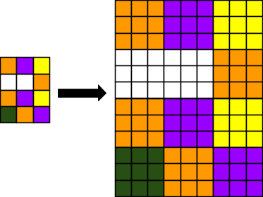
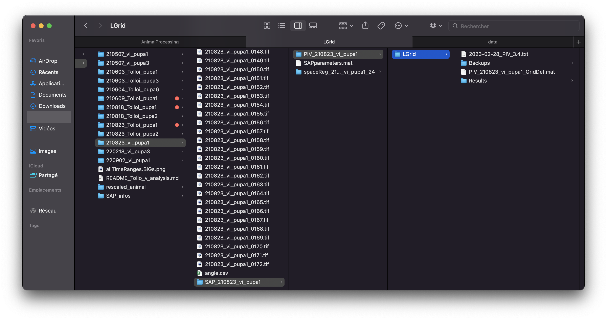

# Running PIV

**Warning:** This guide assumes that all movies have been rescaled onto the same archetype. Each `SAP_info` should have its `xyStart`, `xFactor`, `yFactor` and `yMid` values set. If that is not the case, refer to the previous guide on [rescaling multiple animals onto an archetype](rescale_animals.md).

## 0. Introduction

Once all `SAP_info` files are updated with the rescaling output, it is time to launch analysis.

`PIV` (Particle Image Velocimetry) tracks deformation of the tissue. This analysis runs on each `SAP_info`, so the process must be enabled in the `SAP_parameters.m` file.

## 1. Launching the analysis

First, set the module to run:

```matlab
%% PROGRAMS TO RUN %%

% PRE-segmentation
TR =    0;                                  % "TimeRegistration" (NO PARAMETERS) (7.12) 
SR =    0;                                  % "SpaceRegistration" (NO PARAMETERS) (7.12) 
PIV =   1;                               % "ParticleImageVelocimetry"
GEP =   0;                                  % "GeneExpressionPattern"
VM =    0;                                  % "VelocityMaps" (with modeVM = 'PIV' OR after cell tracking with modeVM = 'CT')

% POST-segmentation
FFPB =  0;                                  % "FilterFourPixelBlocks" (NO PARAMETERS)
SIA =   0;                                  % "SegmentedImageAnalysis"
CT =    0;                                  % "CellTracking" (NO PARAMETERS)(7.8)
% NB: "HC" ALWAYS RUNS (not in SAP/MAPcall) % "HolesCorrection" (NO PARAMETERS) (8.8) 
CTD =   0;                                  % "CellTrackingDisplay"
CPT =   0;                                  % "CellPatchTracking"
CTA =   0;                                  % "CellTrackingAnalysis" (can also run before CPT in full image mode)
AOS =   0;                                  % "AverageOverSpace"
TA =    0;                                  % "TensorAnalysis"

% Force inference
GV =    0;                                  % "GetVertex" (NO PARAMETERS)
STPE =  0;                                  % "STPEstimate"
MSM =   0;                                  % "MatlabShujiMatcher"
SM =    0;                                  % "StressMap"

% Time averaging
AOT =   0;                                  % AverageOverTime
POT =   0;                                  % PlotOverTime (8.6)
```

Then set the grid properties of the analysis:

```matlab
%% MAIN COMMON PARAMETERS %%

PIVgrid = 'L';              % GRIDSIZE SPECIFICATION (XS, S, M, L, XL). Will specify gridsize to use for PIV, cell tracking and to name folders (moved here 8.6)

excludeLostCells = 2;       % CPT filtering of cells. 0: no filtering; 1: excluding cells getting lost OR losing ALL daughters; 2: excluding cells losing 1+ daughter (moved 7.6)
minCycleDuration = 3;       % CTD parameter: in hours, minimal time to allow a new division (does NOT apply to first divisions) (7.5)
    
% Clone related:
cloneTracking = false;      % to track clone parts of tissue AND their WT symmetric counterparts (% midline) (7.0)
nCellsMin = 10;             % number of cells below which a clone part is not analyzed (CPT)

% Grid related:
% '' (full image processing),'E' (Eulerian grid) or 'L' (Lagrangian)
gridType = '';  
% Specifies fraction of overlap between boxes
gridOverlap = 0;            
% Time APF to draw grid to determine cell patches to track. Can also be "start" or "final". ONLY relevant for LGrids (6.7).
gridTime = 'start';         

% NB: if cloneTracking = true, "gridTime" will be overridden by "cloneMaskTime" which is determined by "cloneMaskFrame" that is either directly specified in SAP_info or
% that is extracted from the last characters of "path2cloneMask". In other words, the frame (=> time) corresponding clone mask determines the time at which it is applied.

% "merged" (ellipse), "split+"/"split-" (circle & dev+/- parts), "circle", "dev+" and "dev-" 
plotType = 'split+';        

% Time at which image was clicked to determine macrochaetes
clickTime = '17h00';
```

Two parameters are particularly important in this configuration:

**1. `PIVgrid` variable:**

```matlab
% GRIDSIZE SPECIFICATION (XS, S, M, L, XL). Will specify gridsize to use for PIV, cell tracking and to name folders (moved here 8.6)
PIVgrid = 'L';              
```

This specifies the size of the grid (in pixels) for the analysis. A smaller grid yields more precise results at the cost of increased computation time.

**Note:** As images have gained in resolution over the years, structures are now larger in terms of pixels as shown below:



For that reason, it is now standard practice to increase the PIVgrid size to `"L"` from `"M"` to account for that shift.

**2. `gridType` variable:**

```matlab
% Grid related:
% '' (full image processing),'E' (Eulerian grid) or 'L' (Lagrangian)
gridType = '';  
% Specifies fraction of overlap between boxes
gridOverlap = 0;            
% Time APF to draw grid to determine cell patches to track. Can also be "start" or "final". ONLY relevant for LGrids (6.7).
gridTime = 'start';     
```

* **Eulerian grid** fixes a grid at the time specified in `gridTime` and describes the deformation with reference to this grid. The structures move with respect to the fixed grid.
* **Lagrangian grid** fixes a grid at the time specified in `gridTime`, but the grid follows the deformation of the tissue. This ensures that what is inside the grid at the time of setup remains in it throughout the deformation. It allows direct comparison of a patch through time at the cost of obscuring the deformation in the movie.
* Setting `gridType = ''` computes both.

To compute both grid types, set `gridType = ''`.

**Once everything is configured, run all SAP_info files.**

*On an M1 Mac with 16 GB RAM, processing a movie takes roughly 40 minutes.*

**Note:** The Parallel Computing Toolbox is required for this analysis. If it is not installed, an error message with an installation link will appear.

**Note:** All `SAP_info` files can be run in a single script to avoid waiting between runs. An example script:

```matlab
clear; close all; clc;
SAP_info_210507_vi_pupa1;
clear; close all; clc;
SAP_info_210507_vi_pupa3;
clear; close all; clc;
SAP_info_210603_Tolloi_pupa1;
clear; close all; clc;
SAP_info_210603_Tolloi_pupa3;
clear; close all; clc;
SAP_info_210604_Tolloi_pupa6;
clear; close all; clc;
SAP_info_210818_Tolloi_pupa2;
clear; close all; clc;
SAP_info_210823_Tolloi_pupa2;
clear; close all; clc;
SAP_info_210823_vi_pupa1;
clear; close all; clc;
SAP_info_220218_vi_pupa3;
clear; close all; clc;
SAP_info_220902_vi_pupa1;
```

The `clear; close all; clc;` commands ensure that variables set from the previous `SAP_info` call do not interfere with the next one.

## 2. Results of the analysis

Once the analysis is complete, each movie folder should contain a new SAP folder named `PIV_name-of-the-folder`.

This folder contains a subfolder called `LGrid`.



Inside the subfolder, multiple files and folders are stored:

* **2023-02-28_PIV_3.4.txt**

* **Backups:**
  * Contains a list of `.mat` files for each frame of the original movie minus one (e.g., `PIV_210823_vi_pupa1_0001.mat` to `PIV_210823_vi_pupa1_0171.mat`).

* **PIV_210823_vi_pupa1_GridDef.mat**

* **Results:**
  * Contains the same list as the one in Backups, in PNG format.

## 3. Next steps

Now that PIV has been run, the next analyses to perform are `VelocityMaps` and `AverageOverTime`.

Proceed with `VelocityMaps`: [Running VM](velocity_maps.md)
