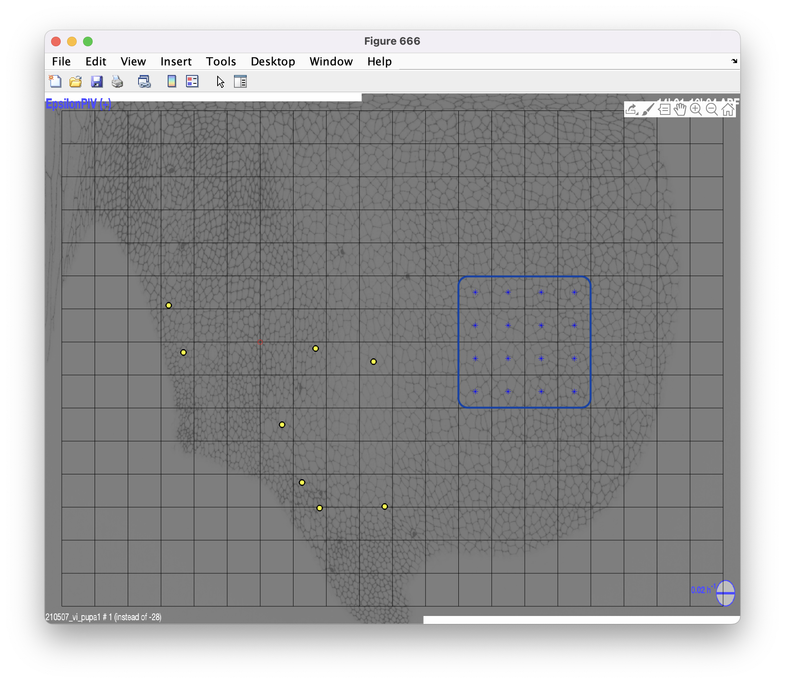
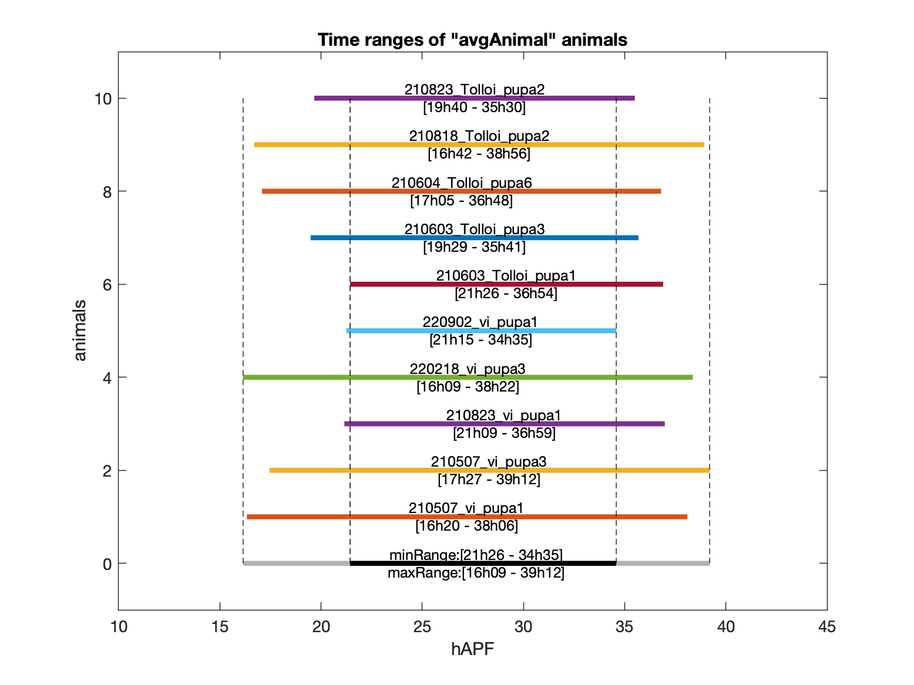

# Timing Movies with PTE and UPIV_get_time

```{warning}
This guide assumes that `AOA` has already been run for the movies in question. If not, consult the previous guide on [Running AOA](average_over_animals.md).
```

## 0. Introduction

`PTE` (PlotTimeEvolution) produces distributions of previously computed quantities within a selected region, plotted against time. Because it operates on distributions across multiple animals, it is configured through the `MAP_parameters.m` script.

## 1. Launching the Analysis

Set `PTE = 1` in the operation selection block:

```matlab
%% Operation Name (Oname) Selection / PROGRAMS TO RUN %%

% PRE-segmentation
RA = 0;                % "RescaleAnimals"

% POST-segmentation
AOA = 0;               % "AverageOverAnimals"
DBA = 0;               % "DifferenceBetweenArchetypes"
POA = 0;               % "ProjectionOverAnimals"
PTE = 1;               % "PlotTimeEvolution"
```

Next, configure the PTE-specific parameters:

```matlab
%% PTE %%

% Origin of the quantities to plot: "AOA" or "DBA"
QplotOrigin = 'AOA'; 
% "inst" or "cum" for cumulative
QplotType = 'inst';  
% "raw" or "renorm": all curves datapoints have their absolute max reset to 1 and become dimensionless 
QplotRenorm = 'raw';         

%%% Enter any quantity listed in "allQs" of "AllQsColorsUnits.m" file: 
QnamePTE = {'UPIV'};
%--------------------------------------------------------------------------
% NB: for VM quantities, must add 'PIV' or 'CT'. Ex: U-> UPIV,...
%--------------------------------------------------------------------------

%%% Enter component ('xx','yy','xy','yx') or unitary tensor ('u0','u1','u3','uPar','uOrt') you want to project on:
Qtags = {'xx','yy'};
%--------------------------------------------------------------------------
% NB: to determine 'uPar' and 'uOrt', parameters defined in POA section
% will be used to load corresponding animal backup.
% NB: scalar quantities listed in "QnamePTE" will just NOT be projected
%--------------------------------------------------------------------------

```

- `QplotOrigin = 'AOA';` -- Specifies the origin of the values to plot. Since `AOA` was used previously, set it accordingly.

- `QplotType` -- Specifies whether to display the cumulative distribution or instantaneous values against time.

- `QnamePTE` -- Selects the quantity to represent. For timing movies based on the migration peak, use `QnamePTE = {'UPIV'};`.

- `Qtags` -- Selects which tensor components to plot. To examine both vertical and horizontal velocity, set `Qtags = {'xx','yy'};`.

Further down in the script, parameters control the spatial region selection:

```matlab
% range of zone to analyse over time, box COORDINATES XYs centered on animal origin
% NB: COORDINATE [0 0] corresponds to box having the animal origin at its ULC
%%%%%%%%%%%%%%%%%%%%%%%%%%%%%%%%%%%%%%%%%%%%%%%%%%%%%%%%%%%%%%%%%%%%%%%%%%%
% Qboxes = {[xMin yMin xMax yMax]};    % for defining a rectangle area
% Qboxes = {[x y];[x y]; ... ;[x y]};  % for defining a list of boxes
% Qboxes = 'full';                     % for analysing the entire grid
% Qboxes = [];                         % for starting the GUI
% Qboxes = {[0 0]};                    % [0 0] corresponds to box containing the origin 
%%%%%%%%%%%%%%%%%%%%%%%%%%%%%%%%%%%%%%%%%%%%%%%%%%%%%%%%%%%%%%%%%%%%%%%%%%%

Qboxes = [];   
path2BackgroundMap = '/path/to/movies/movies_v_Tollo/210507_vi_pupa1/SAP_210507_vi_pupa1/AOT_210507_vi_pupa1/EGrid_xy_1253_563_wh_204.2x235.1_nynx_8x18/Average_2h_14h00_to_32h00_olap_0.96/split+/EpsilonPIV_210507_vi_pupa1_14h01-16h04_sr=5e+03.png';

% Axis range, leave empty for automatic range selection, otherwise like this: {[400 410]}
Qrange = {};
```

- `Qboxes` -- Selects the region for which to obtain the plots. As described in the comments, setting `Qboxes = [];` opens a GUI for manual region selection.

- `path2BackgroundMap` -- Provides a background image to help visualize the grid. Any image computed during `VM` for a single movie can be used here.

**Launch the process by clicking `start` in `MAP_parameters.m`.**

A prompt will appear to validate a grid. Press "Yes" to continue.

Next, a prompt will appear to select the region to analyze. Click on the desired squares and press `q` to validate. Alternatively, click the top-left and bottom-right corners to define the region.

**For migration timing, it is recommended to select an anterior region, approximately at the level of the first four macrochaetae along the y-axis.**



## 2. Results of the Analysis

New folders appear in all `AOA` backups: `Plots_PTE`, which contains the computed plots:

- **avgAnimal.all.UPIV.xx_inst_raw_(6,-2)-(8,-2).mat** and **avgAnimal.all.UPIV.xx_inst_raw_(6,-2)-(8,-2).png** -- The horizontal-direction plot values and the corresponding plot image.

- **avgAnimal.all.UPIV.yy_inst_raw_(6,-2)-(8,-2).mat** and **avgAnimal.all.UPIV.yy_inst_raw_(6,-2)-(8,-2).png** -- The vertical-direction plot values and the corresponding plot image.

- **avgAnimal.all.UPIV.yy_inst_raw_(6,-2)-(8,-2).GUImap.png** -- An image of the selected grid (see above).

Since the migration peak in the xx direction is the quantity of interest, the corresponding plot is shown below:

-(8,-2).png)

Each movie exhibits a peak in migration. However, the peaks are unsynchronized, which is expected since the timings were initially set arbitrarily. The next step is to assess the 3/4 of the migration peak for each movie and extract the corresponding timings.

## 3. Using a Script to Extract Timings

A helper script is provided to compute the exact timing of the 3/4 migration peak for each movie. This script is called `UPIV_get_time_ref.m` and is located in the `Additional_scripts` folder.

The script contents are as follows:

```matlab
function [avg_animals, list_time_ref,list_frame_ref]=UPIV_get_time_ref(path_Mat,path_animals)
% UPIV_get_time_ref  finds the 3/4 of the migration peak.

% Loading backup
load(path_Mat)

% Assessing number of movies
[~,~,nb_movie]=size(value);

% Assessing the names of the animals 
avg_animals = split(legendQname, '.');
avg_animals = avg_animals(2:end, 1);

% Will contain the time refs and frame refs
list_time_ref=[];
list_frame_ref=[];

% For each movie
for i=1:(nb_movie-1)
    
    % We get the name of the animal
    animal = string(avg_animals(i));
    
    % We set the path for the SAPparameters.mat backup in the SAP_folder
    path_animal_complete = strcat(path_animals,sprintf('/%s',animal));
    path_animal_complete = strcat(path_animal_complete,sprintf('/SAP_%s',animal));
    path_animal_complete =strcat(path_animal_complete,sprintf('/SAPparameters.mat'));
    
    % We load the SAP backup
    load(path_animal_complete,'timeRef','frameRef','dt','nFrames')
    
    % We fetch the minimum value and its frame
    [X,timepoint_start]=min(value(:,1:nFrames/2,i+1))
    
    % We fetch the match value and its frame
    [n,l]=max(value(:,timepoint_start:end,i+1))
    
    % We fetch the frame value for which it is equal to 3/4 of the
    % migration peaks
    n=n*3/4;
    [~,l2]=min(abs(value(:,timepoint_start:l+timepoint_start,i+1)-n));
    
    time_ref=TimeDecArray(l2+timepoint_start);
    list_time_ref=[list_time_ref ; time_ref];
    list_frame_ref=[list_frame_ref ; round(time2frame(time_ref,timeRef,frameRef,dt))];
end
end
```

This function takes as input:

1. The path to the `PTE` backup `.mat` file for the xx direction.
2. The path to the folder containing all movies (e.g., `movies_v_Tollo`).

It returns three variables:

1. `avg_animals` -- The animal names corresponding to the calculation.
2. `list_time_ref` -- The timing of the 3/4 peak (meaningful only after movies have been properly timed).
3. `list_frame_ref` -- The frame at which 3/4 of the peak is attained. This is the most important output for initial timing.

To call the function from the MATLAB console (the `Additional_scripts` folder must be added to the MATLAB path via **HOME > Set Path**):

```matlab
[animals, timings, frames] = UPIV_get_time_ref('/path/to/movies/movies_v_Tollo/AOA_avgAnimal_2h_0.96olap/Plots_PTE/avgAnimal.all.UPIV.xx_inst_raw_(6,-2)-(8,-2).mat', '/path/to/movies/movies_v_Tollo')
```

Example output:

```matlab
animals =

  10x1 cell array

    {'210507_vi_pupa1'    }
    {'210507_vi_pupa3'    }
    {'210823_vi_pupa1'    }
    {'220218_vi_pupa3'    }
    {'220902_vi_pupa1'    }
    {'210603_Tolloi_pupa1'}
    {'210603_Tolloi_pupa3'}
    {'210604_Tolloi_pupa6'}
    {'210818_Tolloi_pupa2'}
    {'210823_Tolloi_pupa2'}
```

```matlab
timings =

   26.3833
   25.2750
   21.5667
   26.5667
   24.6250
   22.0333
   23.2333
   25.6417
   26.0083
   23.0500
```

```matlab
frames =

   105
    93
    53
   107
    86
    58
    71
    97
   101
    69
```

The `timeRef` variable should now be updated to 22h00, and `frameRef` set to the frames obtained above, in each `SAP_info` file. It is recommended to verify that these values are consistent with the PTE plot before proceeding.

## 4. Conclusion

With the timing now determined for all movies, the entire analysis pipeline can be re-run in sequence: 1. `SR` 2. `RA` 3. `VM` 4. `AOT` 5. `AOA` 6. `PTE`.

This time, all movies will be synchronized, and the results can be interpreted quantitatively.

**Note:** After running the full pipeline up to `PTE`, some intermediate results can be examined:

1. **Time ranges obtained from `AOA`:**



2. **EpsilonPIV through time in the same region as before, from `PTE`:**

-(9,-2).png)

As shown, the movies are fully synchronized in time after the rescaling procedure.