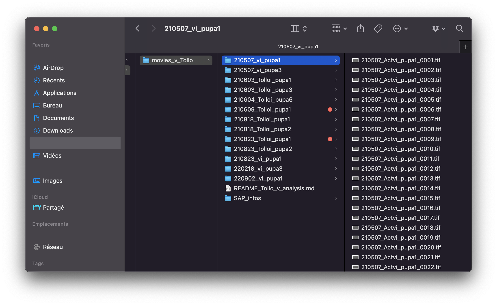
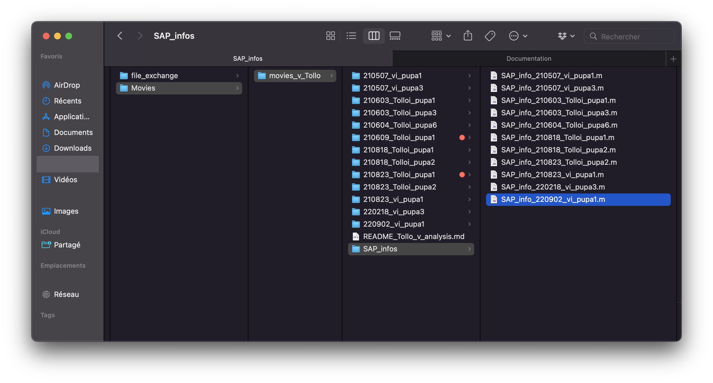
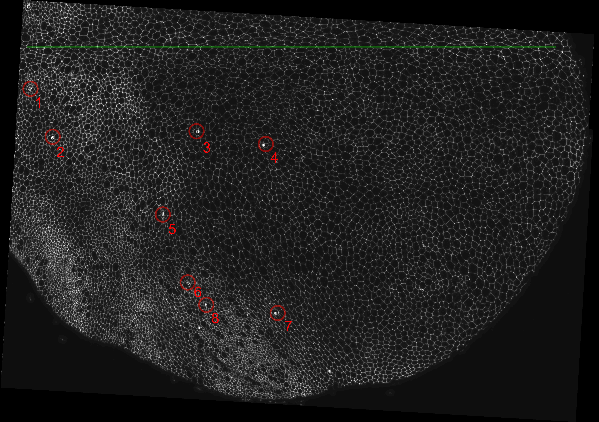

# Preparing movies

To begin using the pipeline, all images must be in the proper format with the correct characteristics and folder structure.

It is assumed that the movie is already restored, projected, and rotated. If that is not the case, the restoration, projection, and rotation steps should be completed before proceeding.

## 1. Regarding folder structure

Start by creating a folder related to the analysis to be performed. It is strongly advised to use a network drive or server with sufficient storage capacity.

For example, to compare v<sup>RNAi</sup> to Tollo<sup>RNAi</sup> movies, create a folder called `movies_v_Tollo` and store the analysis in it.

Next, create a folder for each movie to be analysed. It is good practice to keep folder and file names as short as possible, since overly long names can cause problems during file transfers and long paths are not handled well by Windows.

For this example, the following movies are used:

* Tollo<sup>RNAi</sup>:
  * 210603_Tolloi_pupa1
  * 210603_Tolloi_pupa3
  * 210604_Tolloi_pupa6
  * 210609_Tolloi_pupa1
  * 210818_Tolloi_pupa1
  * 210818_Tolloi_pupa2
  * 210823_Tolloi_pupa1
  * 210823_Tolloi_pupa2
* v<sup>RNAi</sup>
  * 210507_vi_pupa1
  * 210507_vi_pupa3
  * 210823_vi_pupa1
  * 220218_vi_pupa3
  * 220902_vi_pupa1

It is also good practice to include a log file explaining potential issues during the analysis, so that anyone reviewing the results can understand the thought process.

The folder structure should therefore look like this:



## 2. Regarding the files themselves

Inside each folder, all images related to the movie should be located directly. They should follow this naming convention:

`name-of-the-folder_XXXX.tif` where the number of digits is determined by the `nDigits` variable in the `SAP_info` file.

File numbers should start with 1, e.g.: `name-of-the-folder_0001.tif`

The files should:

1. Be stored as a sequence of TIF files, properly named
2. Have the correct bit depth: 8 bits
3. Be correctly rotated, meaning that the midline of the animal should be as horizontal as possible

These steps can be done using a combination of Fiji commands and standard restoration/projection/rotation tools.

## 3. Quality checks on the movies

Before committing to any analysis, it is a good idea to perform some quality checks on the movies depending on the kind of analysis to be performed.

In particular, verify that:

1. The sequence is complete: every frame between the first and last is present and numbered without gaps (a missing frame stops the pipeline).
2. The images are 8-bit — the pipeline checks this at startup and stops if they are 16-bit.
3. The rotation is correct: the midline should be as horizontal as possible, since spatial registration and the common grid assume this orientation.
4. The movie is usable frame to frame: no large jumps, out-of-focus frames, or projection artifacts, which degrade PIV and tracking results.

Any issue found (and how it was handled) should be recorded in the log file mentioned above.

## 4. Creating the SAP_infos

Now that the data is properly stored, the SAP_infos corresponding to each movie need to be created.

A template is available in `Parameters_demo/SAP_info_BIGwt2_demo_DEMO.m` in the repository itself.

As good practice, the SAP_info files should be stored next to the data itself in a separate folder, so that nothing is lost between transfers.

The naming convention for each of the newly created SAP_infos is: `SAP_info_name-of-the-folder.m`

The analysis folder should now look like this:



## 5. Initializing the SAP info files

Now that the `SAP_info` files have been created, their content needs to be modified according to the location of the data and other variables. For an extended description of the content of an SAP_info file, see the [SAP_info guide](sap_info.md).

### Example with the movie `210823_vi_pupa1`

Here is the first image of the movie, `210823_vi_pupa1_0001.png`:



On this image, common morphological features of a developing notum can be identified:

1. The midline, indicated as a green line
2. The macrochaetae annotated from 1 to 8. The numbering of the macrochaetae follows a convention and is therefore always the same

Here is the content of the `SAP_info_210823_vi_pupa1.m` associated with it:

```matlab
%% Frames to process %%

startFrame = 1;                
finalFrame = 172;      

%% Path to raw images %%
pathFolderRaw = '/path/to/movies/movies_v_Tollo/210823_vi_pupa1';

% Can be multiple: {'pten_myo_' ; 'pten_baz_' ; ...}. NB: PIV will use FIRST listed
filenameRaw = {'210823_vi_pupa1'};  
% "Cad", "Myo", "Mud"... (start with capital, names must be used consistently between animals)
signalName = {'Cad'};  
% Number of digits that WAS used for naming RAW IMAGES.
nDigits = 4;  
% Image extension
imageFormatRaw = 'tif';                     

%% Synchronization & Scale %%

halfNotum = 'r'; % Chose between 'l' (left) 'r' (right) and 'b' 'both'
frameRef = 100; % frame # corresponding to "timeRef" determined by "TimeRegistration"
timeRef = '22h00'; % "timeRef" ('HH:MM' or decimal) corresponding to "frameRef" above
dt = 5; % time IN MINUTES between two frames
temperature = 29;  % temperature (25 or 29C) at which development was filmed
yMid = []; % y of midline IN PIXELS (leave empty [] if unknown)
scale1D = 0.161; % Length of one pixel IN MICRONS (if 1 pixel is 0.1 um enter 0.1) 

%% Box/Grid specifications (PIV, CPT, AOS, TA, SM) %%

% X scaling factor from "RescaleAnimals". Animals LONGER than archetype: xFactor > 1
xFactor = 1;
% Y scaling factor from "RescaleAnimals". Animals WIDER than archetype: yFactor > 1
yFactor = 1;                                
% grid compartment size IN PIXELS [WIDTH HEIGHT]. One value => square grid
boxSize = [40 40]/scale1D ./ [xFactor yFactor];   
% xy coordinates (Upper Left Corner)of FIRST compartment. If empty, starts at image center.
xyStart = [];                       
% number of compartments [ny nx]. If empty grid fills up image.
gridSize = [];                             

%% Path to clone Mask %%

cloneName = '';                         % name to give to clone ("a-act", "fat"...)
cloneMaskFrame = [];                    % frame number corresponding to clone mask
path2cloneMask = ''; 

%% Scale Bar & Display %%

scaleBarLength = 50;                    % scale bar length in microns
scaleBarWidth = 3;                      % scale bar width (in PIXELS). Used 3 for BIG
xyOffset = [30 70];  % scale bar offset @ bottom right of image IN PIXELS ([30 30] for Potts)
colorBarXYWH = [0.75 0.025 0.15 0.02];    % [left, bottom, width, height] in figure units
imageFading = 0.7;  % fading of background image for tensor maps (0.7 for eLife article)
fontSizeInfo = 18; % 27 TRBL8(res 200), 35 BIG_X,TRBL9,TRBL4(res 150), 55 TRBL7(res 100), 20 BIG (res 300), 40 JESUS(res 200), but 27 (res300) for cad4
imageResolution = 200;  % 300 used for formalism article, 200 for Potts CppTD images, between 300 and 150 for CppTD images

%% "SAP_parameters" call %%
Animal = mfilename;
Animal = Animal(10:end);
SAP_parameters
```

**For this analysis, the most sensitive parameters are:**

1. ```matlab
   timeRef = '22h00'; % "timeRef" ('HH:MM' or decimal) corresponding to "frameRef" above
   frameRef = 100; % frame # corresponding to "timeRef" determined by "TimeRegistration"
   ```

   Because the timings of the movies are initially unknown, it is difficult to determine the appropriate timing target.

   The timings that are typically set are:

   * 18h35 -- corresponds to 3/4 of the cellular rotation peak
   * 20h15 -- corresponds to 3/4 of the cellular division peak
   * 22h00 -- corresponds to 3/4 of the cellular migration peak

   The migration peak is generally the most useful measurement for timing movies, therefore `timeRef = '22h00'` is used.

2. ```matlab
   temperature = 29;  % temperature (25 or 29C) at which development was filmed
   ```

   Because the animals have an RNAi induced with the Gal4Gal80<sup>ts</sup> system, 29 degrees C is selected as the development temperature.

   All the `SAP_info` files are updated in the same fashion, and the analysis can then begin.

Next page: [Performing SpaceRegistration with SR](space_registration.md)