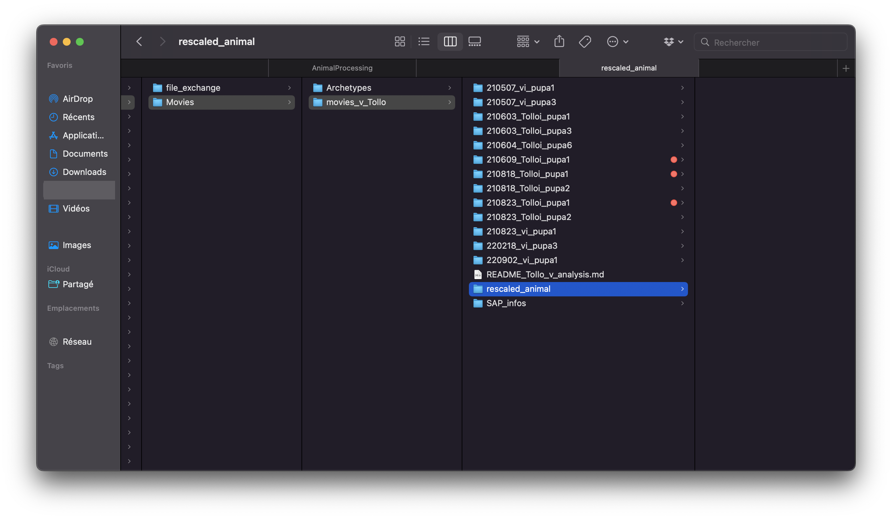
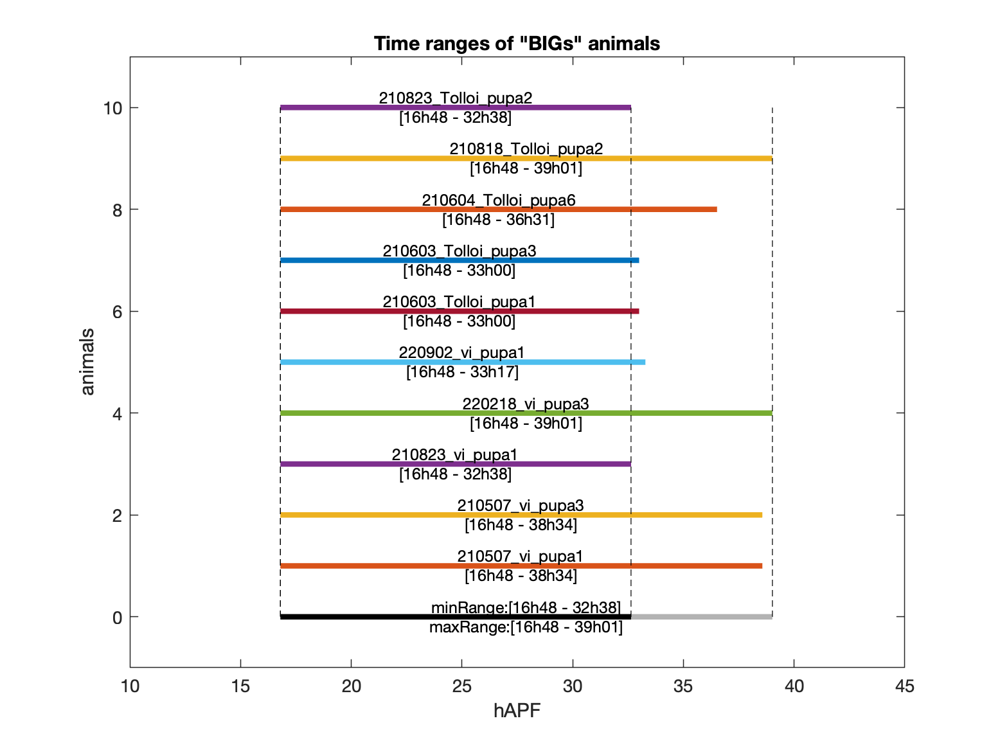
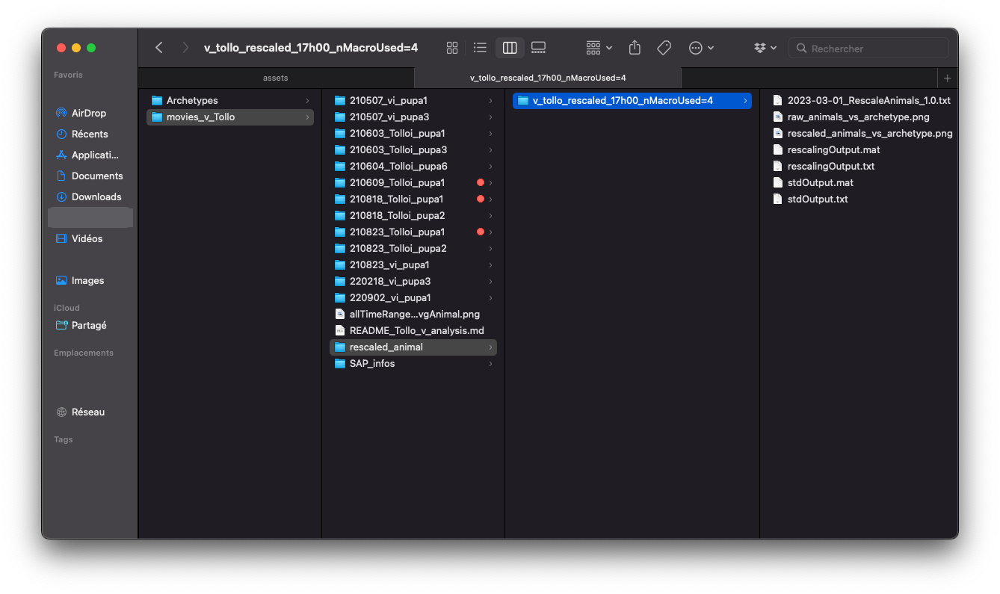
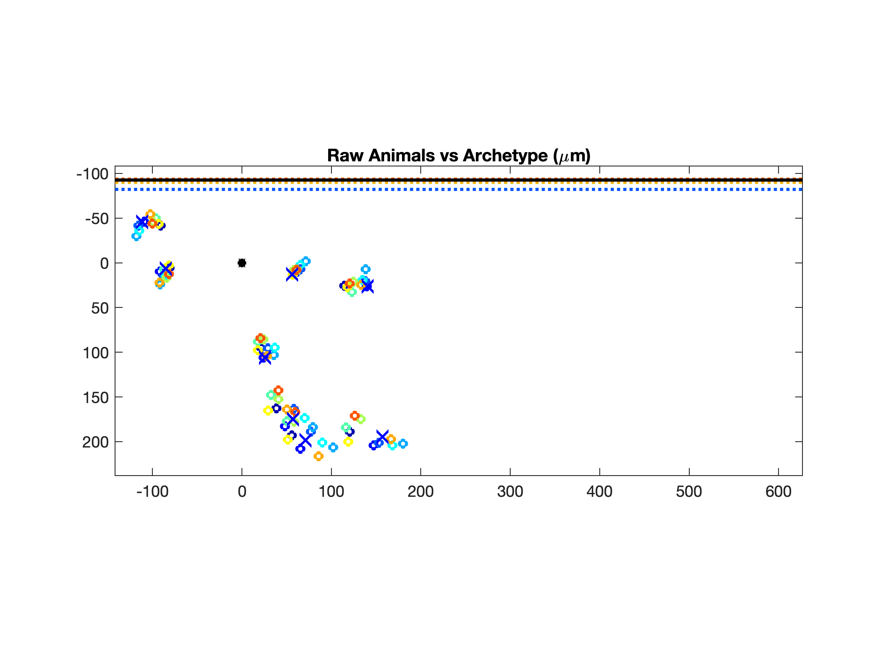
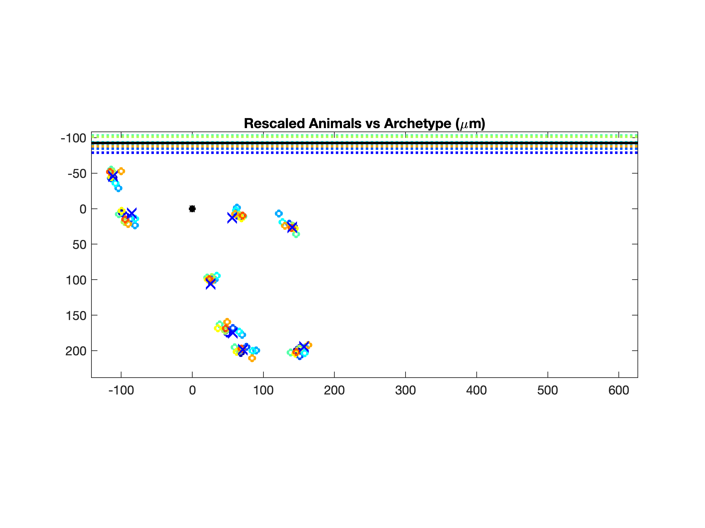
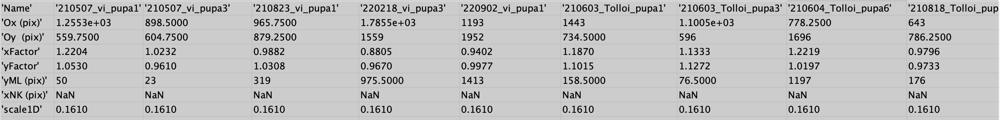

# Rescaling multiple animals

Now that the movies have been registered spatially, it is time to rescale all movies onto a common grid to compare their deformation.

## 1. General information on the module

### What is RescaleAnimals

`RescaleAnimals` (or `RA`) is the module that places all animals on a common grid so that their deformations can be compared.

### Reminders on MAP_parameters

Since this task processes multiple animals, it is located in `MAP_parameters`. General information on `MAP_parameters` is available [here](map_parameters.md).

`MAP_parameters` allows launching a wide variety of modules tied to the analysis of groups of animals/movies. In contrast to `SAP_parameters`, it is not launched with an `SAP_info_XXXX.m` file but directly with variables indicating the names of the animals that will be part of the analysis.

## 2. Launching the analysis

There are multiple variables of interest in `MAP_parameters` that control the rescaling of all animals. The following sections show relevant samples of the `MAP_parameters.m` script.

*For clarity, parts of the original `MAP_parameters.m` script that are not relevant to this analysis have been omitted.*

### 2.1 Defining the animals to compare and the animals used to build a common grid

Here is the section where the animals for the analysis are defined:

```matlab
%% ANIMALS TO INCLUDE %%

% Definition of animal lists often use for analysis:
%--------------------------------------------------------------------------
% Animal lists:
avgAnimals_v = {'210507_vi_pupa1'; '210507_vi_pupa3'; '210823_vi_pupa1'; '220218_vi_pupa3'; '220902_vi_pupa1'}
avgAnimals_Tollo = {'210603_Tolloi_pupa1'; '210603_Tolloi_pupa3'; '210604_Tolloi_pupa6'; '210818_Tolloi_pupa2'; '210823_Tolloi_pupa2'}
```

Note the two groups corresponding to the two conditions of interest.

Now define the name of the average animal with `mapAnimal`, the animals to be averaged with `avgAnimals`, and the path to the movies with `pathName`.

```matlab
%--------------------------------------------------------------------------
% Animals to take into account in the average (selection of one of the above list)
%--------------------------------------------------------------------------
mapAnimal = 'avgAnimal';  
avgAnimals = [avgAnimals_v; avgAnimals_Tollo];
PathName = '/path/to/movies/movies_v_Tollo';    
```

Finally, define which animals the common grid will be built on. Since the grid should be based on all animals being analyzed, set `allAnimals = avgAnimals`:

```matlab
%--------------------------------------------------------------------------
% ALL animals to consider to build commong grid:
%--------------------------------------------------------------------------
allAnimals = avgAnimals;
%--------------------------------------------------------------------------
```

### 2.2 Selecting the process to launch

```matlab
%% Operation Name (Oname) Selection / PROGRAMS TO RUN %%

% PRE-segmentation
RA = 1;                % "RescaleAnimals"

% POST-segmentation
AOA = 0;               % "AverageOverAnimals"
DBA = 0;               % "DifferenceBetweenArchetypes"
POA = 0;               % "ProjectionOverAnimals"
PTE = 0;               % "PlotTimeEvolution"
```

Since the goal is to rescale animals, set `RA = 1` and all other modules to `0`.

### 2.3 Specificities of `RescaleAnimals`

`RescaleAnimals` has specific properties highlighted below:

```matlab
%% RA - RescaleAnimals (3.0)%%

% "Archetype" to CREATE archetype OR "Rescale" to use existing archetype for RESCALING
rescaleMode = 'Rescale';      

% Time at which landmarks were clicked IN ALL MOVIES
clickTimeAll = '17h00';   

% Minimum number of macrochaetes AVAILABLE (ON EACH SIDE OF ANIMAL if halfNotum = 'b') in all animals to process (USED TO CALCULATE BARYCENTERS)
nMacroMin = 4;                 

```

`RescaleAnimals` can operate in multiple modes, defined by the `rescaleMode` variable:

```matlab
% "Archetype" to CREATE archetype OR "Rescale" to use existing archetype for RESCALING
rescaleMode = 'Rescale';   
```

If `rescaleMode` is set to `'Archetype'`, `RA` will create an Archetype folder at the location specified by `parentArchetypeFolder`. The archetype serves as the spatial reference template onto which all animals are rescaled.

For this example, an existing Archetype is used. This archetype has a `clickTime` set at 17h00. **During rescaling, the `clickTime` of all individual movies should match the `clickTime` of the archetype.**

```matlab
% Time at which landmarks were clicked IN ALL MOVIES
clickTimeAll = '17h00';   
```

Next, set the minimal number of macrochaetae used (per half notum) to rescale the movies together. The value 4 is selected since the archetype used only has 4 macrochaetae clicked.

```matlab
% Minimum number of macrochaetes AVAILABLE (ON EACH SIDE OF ANIMAL if halfNotum = 'b') in all animals to process (USED TO CALCULATE BARYCENTERS)
nMacroMin = 4;     
```

### 2.4 On the Archetype

```matlab
%%% Archetype related:

% PARENT folder that will contain archetypes made at different clicking times
parentArchetypeFolder = '/path/to/movies/Archetypes/';

% Prefix that will appear before "archetype_..." in folder name
archetypeName = 'Gene_';                                          

%%% Rescaled animal related:
% PARENT folder that will contain rescaled animals made at different clicking times
parentRescaledAnimalsFolder = '/path/to/movies/movies_v_Tollo/rescaled_animal/';  
% prefix that will appear before "rescaled_..." in folder name
rescaleName = 'v_tollo_';   

makeSVG = false;
```

First, specify the location of the folder containing the Archetype to be used for rescaling as well as the name of the archetype folder:

```matlab

% PARENT folder that will contain archetypes made at different clicking times
parentArchetypeFolder = '/path/to/movies/Archetypes/';
% Prefix that will appear before "archetype_..." in folder name
archetypeName = 'Gene_';    
```

Then specify the location of the rescaled animal output that the rescaling procedure will produce, as well as the prefix of its name (the rest of the name is determined by the parameters of the rescaling, such as the number of macrochaetae clicked and the `clickTime`):

```matlab
%%% Rescaled animal related:

% PARENT folder that will contain rescaled animals made at different clicking times
parentRescaledAnimalsFolder = '/path/to/movies/movies_v_Tollo/rescaled_animal/';  
% prefix that will appear before "rescaled_..." in folder name
rescaleName = 'v_tollo_';                                            
```

Create the directory associated with the output. The repository should look like this by now:



### 2.5 Running the script

Press **RUN** on `MAP_parameters` to launch the process.

## 3. Results of the analysis

**A new image should appear** in the repository with the name corresponding to the `mapAnimal` value (in this case it is called `allTimeRanges.avgAnimal.png`). This image shows the different time spans of all movies compared to one another. Note that at this point the time ranges are not yet meaningful, since the movies have not been time-registered yet.



**A new folder should also appear in the repository, looking like this:**



* `2023-02-27_RescaleAnimals_1.0.txt` contains general information on how the rescaling was performed.
* `raw_animals_vs_archetype.png` shows all macrochaetae plotted against the archetype before rescaling. This allows identification of potential issues during the procedure.



* `rescaled_animals_vs_archetype.png` shows all macrochaetae plotted against the archetype after rescaling.



* `rescalingOutput.mat` and `rescalingOutput.txt` contain a table with the new coordinates of all movies after rescaling.



* `stdOutput.txt` contains metrics about rescaling quality, such as the standard deviation in X and Y of all macrochaetae.

## 4. Update SAP infos

Now that these values are available, the `xyStart`, `xyFactors`, and `yMid` variables of each `SAP_info` file can be filled in. This enables subsequent analyses on a common grid.

**Note:** Variable names differ slightly between the `rescalingOutput.txt` file and the variables in the `SAP_info`. Specifically, `xyStart = [Ox Oy]` and `yMid = yML`. These values must be transferred manually, as the pipeline does not update the SAP_info files automatically after rescaling.

## 5. Next up

Now that every `SAP_info` is updated, proceed to the next step: [PIV](piv.md).
