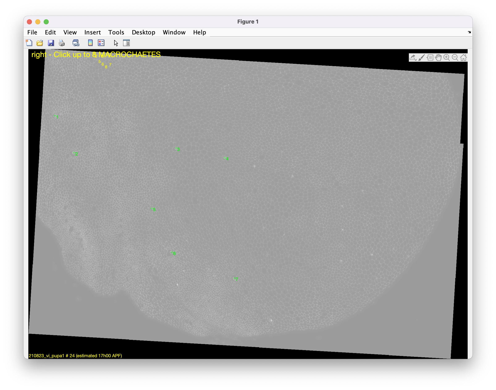
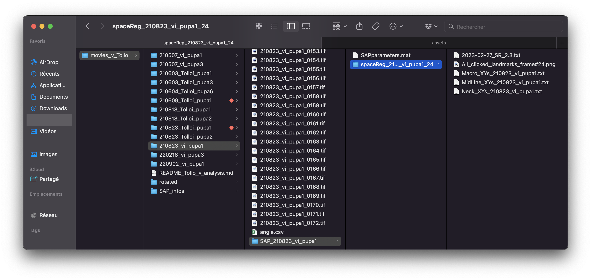
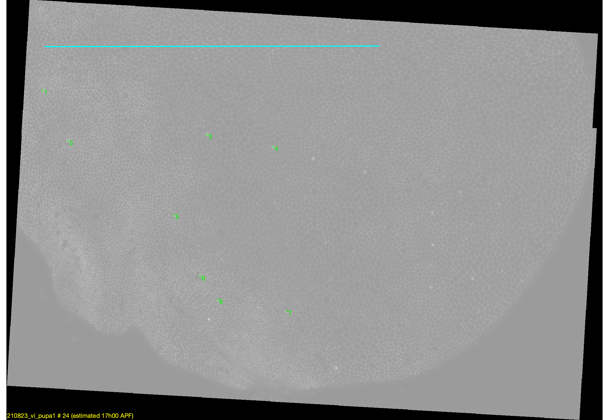

# Performing SpaceRegistration of the movies

Since the goal of this tutorial is to rescale all movies time-wise using the peak of rotation and migration, all animals must first be rescaled space-wise and PIV must be launched.

The first step therefore consists of spatially registering all movies individually. This is done by launching the `SpaceRegistration` module of `SAP_parameters.m`.

## 1. Launching the analysis

Set the `SR` variable to 1 in `SAP_parameters.m` and all other processes to 0.

```matlab

%% PROGRAMS TO RUN %%

% PRE-segmentation
TR =    0;                                  % "TimeRegistration" (NO PARAMETERS) (7.12) 
SR =    1;                                  % "SpaceRegistration" (NO PARAMETERS) (7.12) 
PIV =   0;                               % "ParticleImageVelocimetry"
GEP =   0;                                  % "GeneExpressionPattern"
VM =    0;                                  % "VelocityMaps" (with modeVM = 'PIV' OR after cell tracking with modeVM = 'CT')

% POST-segmentation
FFPB =  0;                                  % "FilterFourPixelBlocks" (NO PARAMETERS)
SIA =   0;                                  % "SegmentedImageAnalysis"
CT =    0;                                  % "CellTracking" (NO PARAMETERS)(7.8)
% NB: "HC" ALWAYS RUNS (not in SAP/MAPcall) % "HolesCorrection" (NO PARAMETERS) (8.8) 
CTD =   0;                                  % "CellTrackingDisplay"
CPT =   0;                                  % "CellPatchTracking"
CTA =   0;                                  % "CellTrackingAnalysis" (can also run before CPT in full image mode)
AOS =   0;                                  % "AverageOverSpace"
TA =    0;                                  % "TensorAnalysis"

% Force inference
GV =    0;                                  % "GetVertex" (NO PARAMETERS)
STPE =  0;                                  % "STPEstimate"
MSM =   0;                                  % "MatlabShujiMatcher"
SM =    0;                                  % "StressMap"

% Time averaging
AOT =   0;                                  % AverageOverTime
POT =   0;                                  % PlotOverTime (8.6)
```

The `clickTime` variable must also be set. It corresponds to the moment in the life of the animal when the space registration is performed.

This parameter is important later in the analysis. The movies are rescaled onto an archetype, and the `clickTime` of the archetype and the `clickTime` of the SpaceRegistration must match.

For now, these movies are rescaled onto an archetype made at 17h00, so `clickTime = '17h00';`.

```matlab
%% MAIN COMMON PARAMETERS %%
% GRIDSIZE SPECIFICATION (XS, S, M, L, XL). Will specify gridsize to use for PIV, cell tracking and to name folders (moved here 8.6)
PIVgrid = 'S';              

% CPT filtering of cells. 0: no filtering; 1: excluding cells getting lost OR losing ALL daughters; 2: excluding cells losing 1+ daughter (moved 7.6)
excludeLostCells = 2;  
% CTD parameter: in hours, minimal time to allow a new division (does NOT apply to first divisions) (7.5)
minCycleDuration = 3;       
    
% Clone related:
% to track clone parts of tissue AND their WT symmetric counterparts (% midline) (7.0)
cloneTracking = false;      
nCellsMin = 10;             % number of cells below which a clone part is not analyzed (CPT)

% Grid related:
% '' (full image processing),'E' (Eulerian grid) or 'L' (Lagrangian)
gridType = 'L';             
gridOverlap = 0;            % specifies fraction of overlap between boxes

% time APF to draw grid to determine cell patches to track. Can also be "start" or "final". ONLY relevant for LGrids (6.7). 
gridTime = 'start';  
% gridTime = 'start'; 
% gridTime = '17h00';         
% gridTime = '26h00';        
% gridTime = '20h00';     

% NB: if cloneTracking = true, "gridTime" will be overridden by "cloneMaskTime" which is determined by "cloneMaskFrame" that is either directly specified in SAP_info or
% that is extracted from the last characters of "path2cloneMask". In other words, the frame (=> time) corresponding clone mask determines the time at which it is applied.

% "merged" (ellipse), "split+"/"split-" (circle & dev+/- parts), "circle", "dev+" and "dev-" 
plotType = 'split+';  
% time at which image was clicked to determine macrochaetes
clickTime = '17h00'; 
```

Navigate to the `SAP_info_210823_vi_pupa1.m` file and press **RUN**.

This opens a prompt to click on the morphological features of the animal to be analyzed.

The keyboard shortcuts in that prompt are:

```
SpaceRegistration 2.3: processing "210823_vi_pupa1" on frame # 24
---------------------------------------------------------------------------------
+ or up-arrow to zoom in
- or down-arrow to zoom out
"p" to go in pan mode and move image (press any key to get out)
"f" or "F" (shift + f) to save and finish (1st switch to NEXT half in "both" mode) 
```

Here is a picture of the prompt itself:



In that image, 7 of the 8 macrochaetae have already been clicked.

**Note:** If the image shown in the prompt is not satisfactory, the `clickTime` in `SAP_parameters` or the `timeRef` and `frameRef` in `SAP_info` may need adjustment. In particular, adjusting `frameRef` in the `SAP_info` file is recommended. Lowering it will display an earlier frame in development; increasing it will display a later frame.

## 2. Results of the analysis

Launching a module of the AnimalProcessing pipeline always outputs the same file structure: a folder named after the process launched and its main parameters (e.g., `spaceReg_210823_vi_pupa1_24` for `SR` with frame #24). This folder is stored in the `SAP_name-of-the-animal` directory (e.g., `SAP_210823_vi_pupa1`) located alongside the raw images in the analysis folder.

After launching SR, the repository should look like this:



Multiple files are contained within this directory:

* **2023-02-27-SR_2.3.txt:**

Contains the parameters for the launch of the process:

```
Parameters: 

halfNotum =  r
timeRef =  20h00
frameRef =  60
clickTime =  17h00
clickFrame =  24
```

* **All_clicked_landmarks_frame#24.png:** Contains an image of the clicked landmarks.

  

* **Macro_XYs_210823_vi_pupa1.txt, MidLine_XYs_210823_vi_pupa1.txt and Neck_XYs_210823_vi_pupa1.txt**

  These files contain the coordinates of each of the morphological features.

## 3. Repeating the analysis

The same analysis must now be applied to **all animals**.

**Note:** All `SAP_info` files can be run in one script so that there is no need to wait between runs. This is done by writing a batch script. For example:

```matlab
clear; close all; clc;
SAP_info_210507_vi_pupa1;
clear; close all; clc;
SAP_info_210507_vi_pupa3;
clear; close all; clc;
SAP_info_210603_Tolloi_pupa1;
clear; close all; clc;
SAP_info_210603_Tolloi_pupa3;
clear; close all; clc;
SAP_info_210604_Tolloi_pupa6;
clear; close all; clc;
SAP_info_210818_Tolloi_pupa2;
clear; close all; clc;
SAP_info_210823_Tolloi_pupa2;
clear; close all; clc;
SAP_info_210823_vi_pupa1;
clear; close all; clc;
SAP_info_220218_vi_pupa3;
clear; close all; clc;
SAP_info_220902_vi_pupa1;
```

## 4. Next up

The next step is to rescale all animals together onto a common grid. For that purpose, proceed to [Rescaling animals together using RA](rescale_animals.md).
