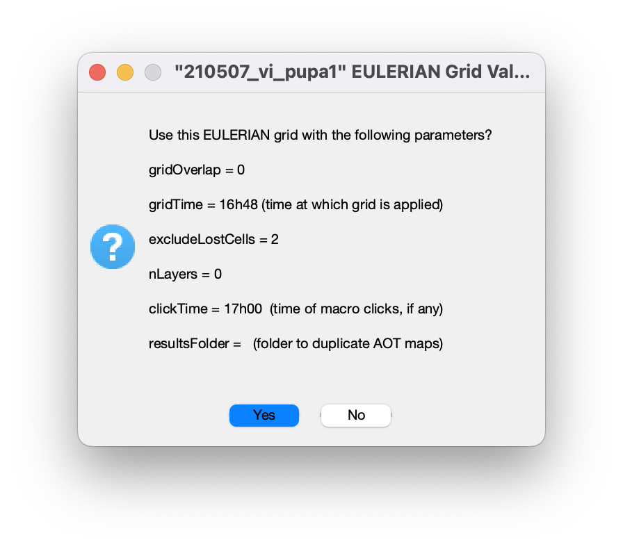
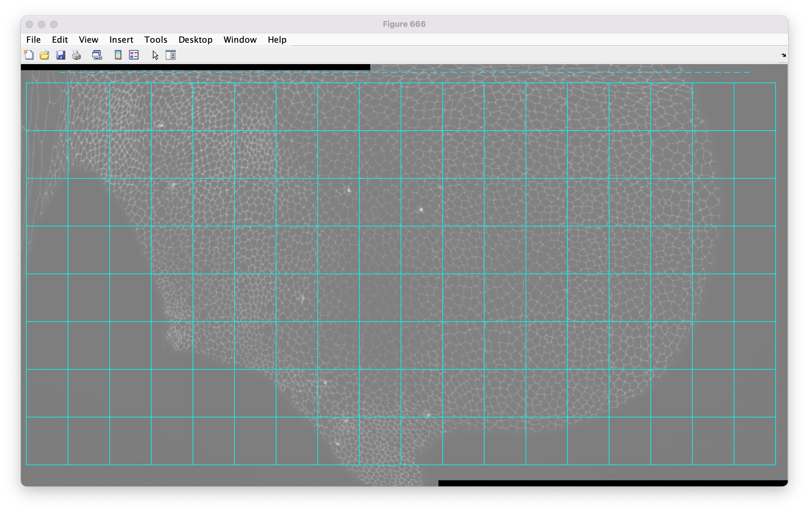
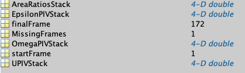
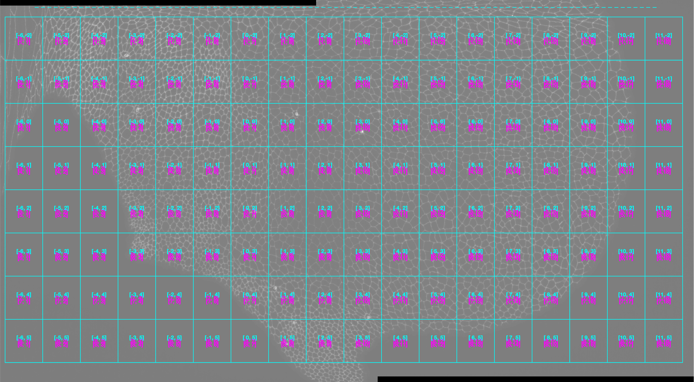
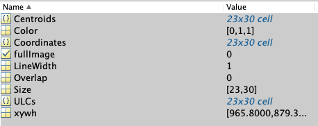

# Running VM

**Warning:** This guide assumes that all movies have been rescaled onto the same archetype. Each `SAP_info` should have its `xyStart`, `xFactor`, `yFactor` and `yMid` values set. If that is not the case, refer to the previous guide on [rescaling multiple animals onto an archetype](rescale_animals.md).

## 0. Introduction

`VM` (VelocityMaps) produces maps of tissue deformation. These maps are subdivided into three categories:

* **UPIV** shows the movement of cell patches
* **EpsilonPIV** shows the contraction and elongation of cell patches
* **OmegaPIV** shows rotation of cell patches

This analysis runs on each `SAP_info`, so the process must be enabled in the `SAP_parameters.m` file.

## 1. Launching the analysis

First, set the module to run:

```matlab
%% PROGRAMS TO RUN %%

% PRE-segmentation
TR =    0;                                  % "TimeRegistration" (NO PARAMETERS) (7.12) 
SR =    0;                                  % "SpaceRegistration" (NO PARAMETERS) (7.12) 
PIV =   0;                               % "ParticleImageVelocimetry"
GEP =   0;                                  % "GeneExpressionPattern"
VM =    1;                                  % "VelocityMaps" (with modeVM = 'PIV' OR after cell tracking with modeVM = 'CT')

% POST-segmentation
FFPB =  0;                                  % "FilterFourPixelBlocks" (NO PARAMETERS)
SIA =   0;                                  % "SegmentedImageAnalysis"
CT =    0;                                  % "CellTracking" (NO PARAMETERS)(7.8)
% NB: "HC" ALWAYS RUNS (not in SAP/MAPcall) % "HolesCorrection" (NO PARAMETERS) (8.8) 
CTD =   0;                                  % "CellTrackingDisplay"
CPT =   0;                                  % "CellPatchTracking"
CTA =   0;                                  % "CellTrackingAnalysis" (can also run before CPT in full image mode)
AOS =   0;                                  % "AverageOverSpace"
TA =    0;                                  % "TensorAnalysis"

% Force inference
GV =    0;                                  % "GetVertex" (NO PARAMETERS)
STPE =  0;                                  % "STPEstimate"
MSM =   0;                                  % "MatlabShujiMatcher"
SM =    0;                                  % "StressMap"

% Time averaging
AOT =   0;                                  % AverageOverTime
POT =   0;                                  % PlotOverTime (8.6)
```

Then set the properties of VM:

```matlab
%% VM PARAMETERS (6.2) %%

% 'CT' to calculate data from TRACKING, 'PIV' to calculate it from PIV. (mod 8.2)
modeVM = 'PIV';   

% PIV grid to be used by VM (can be different than PIVgrid). ONLY relevant in 'PIV' mode
PIVgridVM = 'L';   

% Possible quantities to plot: 'U' ; 'Epsilon' ; 'Omega'
plotTensorsVM = {'U' 'Epsilon' 'Omega'}; 

takeImageNegative = true;

if ~exist('scaleRatioVM','var')
    % Quantities           U   Epsilon   Omega 
    % NB: SHOULD ALWAYS BE LISTED IN THIS ORDER!!
    scaleRatioVM =        {30    5e3      5e3   };
    scaleBarLengthVM =    [5    0.02      0.02  ];
end

killMeanTraceVM = [0 0 0];
```

**Several parameters are important here:**

```matlab
% 'CT' to calculate data from TRACKING, 'PIV' to calculate it from PIV. (mod 8.2)
modeVM = 'PIV';  
```

This sets the **mode** of `VM`. VelocityMaps can use results from either `CT` (CellTracking) or `PIV`. Since CellTracking has not been run at this point, set `modeVM = 'PIV'`.

```matlab
% PIV grid to be used by VM (can be different than PIVgrid). ONLY relevant in 'PIV' mode
PIVgridVM = 'L';   
```

This sets the grid size for the maps. It is recommended to use the same value as the one used for `PIV`, although this is not mandatory.

```matlab
% Possible quantities to plot: 'U' ; 'Epsilon' ; 'Omega'
plotTensorsVM = {'U' 'Epsilon' 'Omega'}; 
```

This line selects which quantities to plot among **UPIV**, **EpsilonPIV**, and **OmegaPIV**. To compute all three, set `plotTensorsVM = {'U' 'Epsilon' 'Omega'};`.

It is also necessary to ensure that the `Grid related` information within the PIV parameters is set for the correct `gridType`. VM run on PIV only works with an Eulerian grid, so this must be set to `'E'`. Setting it to `'L'` produces a warning that VM cannot run on a Lagrangian grid and falls back to Eulerian. Leaving it empty causes an error and VM will not run.

```matlab
% Grid related:
% '' (full image processing),'E' (Eulerian grid) or 'L' (Lagrangian)
gridType = 'E';  
% Specifies fraction of overlap between boxes
gridOverlap = 0;            
% Time APF to draw grid to determine cell patches to track. Can also be "start" or "final". ONLY relevant for LGrids (6.7).
gridTime = 'start'; 
```

**Once everything is configured, run all SAP_info files.**

1. A prompt appears to validate the grid used to compute VM, along with an image of the grid itself:

   

   

   Press **"Yes"** and continue the analysis.

*On an M1 Mac with 16 GB RAM, processing a movie takes roughly 5 minutes.*

## 2. Results of the analysis

Following the analysis, two new folders appear in the `SAP-name-of-the-folder` directory. Their hierarchy is as follows:

1. **AOT_210823_vi_pupa1:** `AOT` stands for `AverageOverTime`.
   * **EGrid_xy_965.8_879.3_wh_129.5x124.2_nynx_23x30** -- named after the parameters of the `SAP_info` file with `xyStart = [965.8_879.3]`, `boxsize = [129.5 124.2]` and `gridSize = [23 30]`
     * **alltime_VM.PIV.L_210823_vi_pupa1.mat** -- contains the values computed by `VM`:

   

2. **CPT_210823_vi_pupa1:** `CPT` stands for `CellPatchTracking`. This folder contains specifics about the grid used for the analysis.

   * **EGrid_xy_965.8_879.3_wh_129.5x124.2_nynx_23x30**

     * **this_Grid_0001.png**: an image of the grid used for the analysis:

       

     * **CPT_210823_vi_pupa1_GridDef.mat:** contains the grid specifications:

       

## 3. Next steps

Now that VM has been run, the next step is to perform `AverageOverTime`.

Proceed with: [Running AOT](average_over_time.md)
